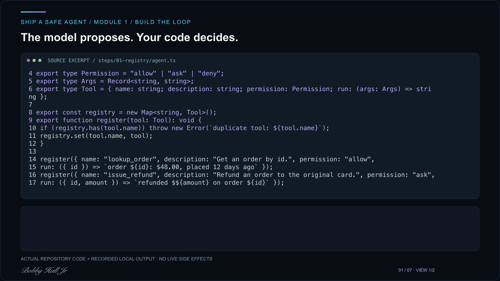

# Ship a Safe Agent: Module 1

<!-- course-walkthrough:start -->
## Video walkthrough

[](https://bhjr.dev/courses/ship-a-safe-agent/module-1#walkthrough)

**[Watch the full walkthrough on BHJR.dev](https://bhjr.dev/courses/ship-a-safe-agent/module-1#walkthrough)** · 3:09 · Normal speed (1×) · Bobby Hall Jr voice narration · English captions

Module 1 and this full walkthrough are free.

[Download the full video](media/walkthrough.mp4) · [English captions](media/captions.vtt)

<!-- course-walkthrough:end -->


Starter repo for Module 1 of **Ship a Safe Agent**: build a tiny agent loop with a tool registry, allow/ask/deny permissions, skills that load on demand, and an event log you can replay.

Lesson: https://bhjr.dev/courses/ship-a-safe-agent/module-1

No API key needed. The "model" is a scripted function, so every run is deterministic and testable.

## Quick start

```bash
npm install
npm start          # runs the finished step 6
npm run check      # typecheck + every step matches its expected output
```

## Steps

Each folder is the full code after that step of the lesson. Run any one with `npm run step steps/<folder>/run.ts` and compare with `expected.txt`.

| Step | Folder | You build |
| --- | --- | --- |
| 1 | `steps/01-registry` | Tool registry with a permission on every tool |
| 2 | `steps/02-permissions` | `checkPermission`: allow, ask, deny |
| 3 | `steps/03-skills-and-context` | Skills that reveal tools only when loaded |
| 4 | `steps/04-fake-model` | A scripted model you can test against |
| 5 | `steps/05-the-loop` | `runAgent` with a step budget and approvals |
| 6 | `steps/06-event-log` | A readable, replayable event log |

## Exercises (graded)

Open `exercise/agent.ts` and replace the three `TODO`s:

1. `shippingModel`: answer "Where is my package?" using only the shipping skill.
2. `runAgentWithBudget`: stop after `maxToolCalls` tool calls.
3. `summarize`: turn an event log into a summary.

```bash
npm test           # fails until you finish; 5 checks
```

Stuck? Compare with the `solution` branch: `git diff main solution -- exercise/agent.ts`.

## License

MIT
